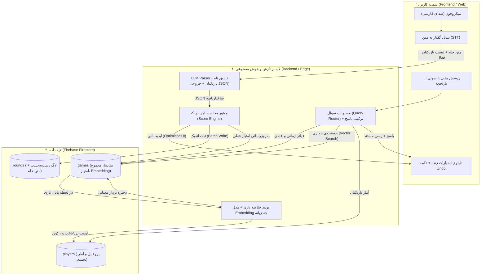

# معماری جریان داده (Data Flow Architecture)

این سند مسیر دقیق حرکت، پردازش، ذخیره‌سازی و بازیابی داده‌ها را در اپلیکیشن **دستیار صوتی ثبت امتیاز و مدیریت بازی‌ها** مشخص می‌کند. برای جلوگیری از پیچیدگی و خطای محاسباتی، کل سیستم به **۳ جریان داده مستقل** تقسیم شده است:

1. **مسیر نوشتن زنده (Write Path):** دریافت فرمان صوتی و ثبت لحظه‌ای امتیازها
2. **مسیر پردازش پس‌زمینه (Async Wrap-up & Indexing):** پایان بازی، آپدیت آمار بازیکنان و آماده‌سازی برای RAG
3. **مسیر خواندن هوشمند (Hybrid RAG Read Path):** پرسش‌وپاسخ از تاریخچه بازی‌ها

---

## نمای کلی جریان داده در سیستم



---

## جریان ۱: ثبت امتیاز زنده با فرمان صوتی (Write Path)

این مسیر حساس‌ترین بخش اپلیکیشن است و باید با کمترین تاخیر (Latency) و بدون خطای محاسباتی اجرا شود.

### مراحل گام‌به‌گام

1. **ضبط و تبدیل صدا به متن (Audio → Raw Text):**
   * کاربر جمله محاوره‌ای را بیان می‌کند (مثال: *«۲۰ امتیاز به سارا بده و ۵ تا از رضا کم کن»*).
   * سرویس STT (مانند `Web Speech API` با زبان `fa-IR` یا `Gemini API`) خروجی متنی خام (`raw_text`) را تولید می‌کند.

2. **تزریق کانتکست و استخراج ساختاریافته (Context Injection → JSON):**
   * متن خام به تنهایی به LLM فرستاده نمی‌شود؛ بلکه همراه با **لیست بازیکنان حاضر در همین بازی** (`active_players`) و **قوانین بازی** ارسال می‌شود تا غلط‌های شنیداری (مثلاً «سارا» به جای «ساره») هوشمندانه اصلاح شوند.
   * مدل زبانی فقط یک آبجکت JSON استاندارد برمی‌گرداند و هیچ محاسبه‌ای انجام نمی‌دهد:

```json
{
  "intent": "UPDATE_SCORE",
  "confidence": 0.96,
  "actions": [
    { "player_id": "p_sara", "operation": "ADD", "value": 20 },
    { "player_id": "p_reza", "operation": "SUBTRACT", "value": 5 }
  ],
  "note": null
}
```

3. **اجرای منطق در موتور محاسبه امن (Deterministic Score Engine):**
   * کد اپلیکیشن (JavaScript/Python) عملیات JSON را اعتبارسنجی می‌کند.
   * امتیاز قبلی هر بازیکن را با `value` جمع یا تفریق می‌کند، رتبه‌بندی جدید را می‌سازد و شرط پایان بازی (مثلاً رسیدن به امتیاز هدف) را چک می‌کند.

4. **به‌روزرسانی آنی رابط کاربری و ذخیره در Firestore:**
   * **UI:** جدول امتیازها بلافاصله آپدیت می‌شود و متن شنیده‌شده همراه با دکمه **بازگشت (Undo)** به مدت چند ثانیه نمایش داده می‌شود.
   * **Firestore (Write Batch):** به صورت همزمان و یکپارچه دو عملیات انجام می‌شود:
     * ایجاد یک سند جدید در `games/{gameId}/rounds/{roundId}` شامل متن خام، آرایه `actions` و زمان ثبت.
     * آپدیت فیلد `current_scores` در سند اصلی `games/{gameId}`.

### جریان بازگشت خطا (Voice Undo Flow)
اگر کاربر بگوید *«قبلی رو برگردون»* یا دکمه Undo را بزند:
* آخرین سندِ فعال در `rounds` به حالت `reverted: true` علامت‌گذاری می‌شود (حذف فیزیکی نمی‌شود تا تاریخچه شفاف بماند).
* موتور محاسبه، مقادیر `actions` همان راند را معکوس کرده و در `current_scores` اعمال می‌کند.

---

## جریان ۲: پایان بازی، متادیتا و نمایه‌سازی برای RAG (Async Path)

هنگامی که کاربر دکمه «پایان بازی» را می‌زند (یا سقف امتیاز پر می‌شود)، جریان پس‌زمینه برای تثبیت آمار و آماده‌سازی حافظه هوشمند اجرا می‌شود:

1. **تثبیت متادیتای بازی:** وضعیت بازی در `games/{gameId}` به `completed` تغییر می‌کند و فیلدهایی مثل `ended_at`، `duration_minutes`، `winner_ids` و یادداشت نهایی ثبت می‌شوند.
2. **آپدیت پروفایل بازیکنان (`players`):** برای هر بازیکن حاضر در بازی، یک تراکنش (Transaction) اجرا می‌شود تا این فیلدها به‌روز شوند:
   * `total_games` (افزایش به اندازه ۱)
   * `total_wins` (در صورت برنده شدن)
   * `win_rate` (بازمحاسبه درصد برد)
   * `highest_score` (در صورت ثبت رکورد جدید در آن نوع بازی)
3. **تولید متنِ قابل‌جستجو (Narrative Summary):** از ترکیب متادیتای بازی و یادداشت‌های مهم راندها، یک پاراگراف فارسی خلاصه و غنی ساخته می‌شود.
   * *نمونه:* «در تاریخ ۲ آذر ۱۴۰۵ بازی کتان در خانه علی برگزار شد. سارا با ۱۲ امتیاز برنده شد، رضا ۹ امتیاز و علی ۷ امتیاز گرفتند. یادداشت شب: سارا در دست آخر با کارت بزرگ‌ترین ارتش بازی را برگرداند.»
4. **تولید بردار معنایی (Embedding Generation):** این خلاصه فارسی به مدل Embedding چندزبانه (مانند `gemini-embedding-001` یا `bge-m3`) داده می‌شود و بردار عددی حاصل در فیلد `embedding` سند `games/{gameId}` ذخیره می‌گردد.

---

## جریان ۳: پرسش‌وپاسخ هوشمند از گذشته با Hybrid RAG (Read Path)

برای اینکه سیستم در سوالات آماری دچار توهم عددی نشود و در سوالات خاطراتی/متنی هوشمند عمل کند، جریان خواندن به شکل **ترکیبی (Hybrid)** طراحی می‌شود:

1. **دریافت سوال کاربر:** کاربر صوتی یا متنی می‌پرسد:
   * *مثال آماری:* «توی یک ماه اخیر کی تو بازی حکم بیشتر برده؟»
   * *مثال معنایی/خاطره‌ای:* «اون شبی که سارا با بزرگ‌ترین ارتش بازی رو برگردوند کی بود و بقیه چند امتیاز گرفتن؟»

2. **تحلیل و مسیریابی سوال (Query Router):**
   یک LLM سبک سوال را به یک پلن جستجو تبدیل می‌کند:

```json
{
  "query_type": "HYBRID",
  "filters": {
    "game_name": "حکم",
    "date_from": "2026-10-22",
    "date_to": "2026-11-22",
    "player_name": null
  },
  "needs_math_aggregation": true,
  "semantic_query": "بیشترین برد در بازی حکم یک ماه اخیر"
}
```

3. **اجرای بازیابی ترکیبی روی Firestore:**
   * **مسیر عددی/فیلتردار:** ابتدا روی کالکشن `games` با فیلترهای `game_name` و بازه `created_at` کوئری زده می‌شود. اگر `needs_math_aggregation` فعال باشد، شمارش بردها، میانگین‌ها یا بیشترین اختلاف امتیاز **توسط کد** محاسبه می‌شود.
   * **مسیر معنایی (Vector Search):** متن `semantic_query` به بردار (Embedding) تبدیل شده و با مقایسه کسینوسی (Cosine Similarity یا متد `findNearest` در Firestore)، ۳ تا ۵ بازی مرتبط بازیابی می‌شوند.

4. **تولید پاسخ نهایی (Grounded Generation):**
   نتایج دقیق محاسبه‌شده توسط کد + خلاصه بازی‌های بازیابی‌شده به LLM داده می‌شود تا یک پاسخ فارسی طبیعی، دقیق و مستند (با ذکر تاریخ و امتیاز واقعی) برای کاربر تولید کند.

---

## ساختار کالکشن‌های Firestore (Data Schema)

برای پشتیبانی روان از هر سه جریان بالا، دیتابیس فقط به **۳ کالکشن** نیاز دارد:

| کالکشن | کلید سند | فیلدهای کلیدی | نقش در جریان داده |
|---|---|---|---|
| **`players`** | `playerId` | `name`, `aliases[]`, `total_games`, `total_wins`, `win_rate`, `stats_by_game{}` | تزریق نام و نام‌های مستعار به پرامپت STT و پاسخ سریع به سوالات پروفایلی |
| **`games`** | `gameId` | `game_name`, `status`, `location`, `created_at`, `ended_at`, `player_ids[]`, `current_scores{}`, `winner_ids[]`, `summary_text`, `embedding[]` | نگهداری وضعیت زنده بازی، فیلترهای زمانی و جستجوی برداری RAG |
| **`games/{id}/rounds`** | `roundId` | `round_number`, `raw_text`, `actions[]`, `note`, `reverted`, `created_at` | آرشیو دست‌به‌دست امتیازها، پشتیبانی از Undo و مشاهده نمودار روند بازی |

---

## نقاط کنترل کلیدی و مدیریت خطا در جریان داده

* **مقابله با نویز محیطی:** اگر `confidence` خروجی LLM پایین‌تر از `0.75` باشد یا نام بازیکن در لیست حاضرین پیدا نشود، داده وارد موتور محاسبه نمی‌شود؛ بلکه یک پیام تایید کوتاه از کاربر گرفته می‌شود (مثلاً: *«آیا منظورت اضافه کردن ۲۰ امتیاز به سارا بود؟»*).
* **تفکیک هوش زبانی از ریاضی:** مدل زبانی **هرگز** مسئول جمع و تفریق امتیازها یا شمارش بردها نیست؛ LLM فقط مترجم بین «زبان محاوره‌ای فارسی» و «ساختار داده JSON» است.
* **مقیاس‌پذیری امن:** تمام تماس‌ها با کلیدهای API (مثل Gemini و مدل Embedding) از طریق لایه میانی (Backend یا Serverless Function) عبور می‌کنند تا کلیدهای محرمانه در کد کلاینت (مرورگر) افشا نشوند.